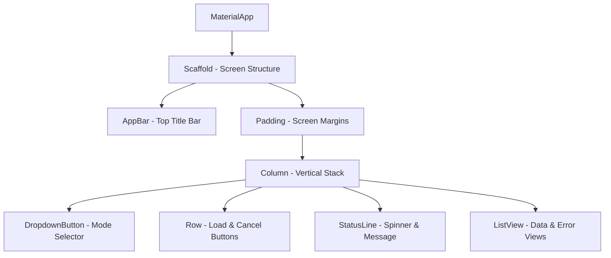
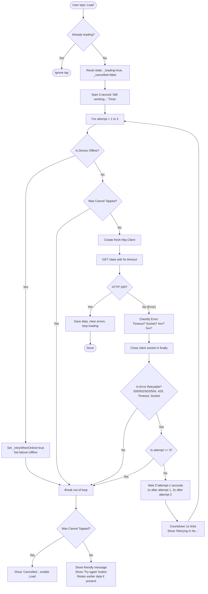

# Comprehensive Beginner's Guide: Resilient Flutter App & Server Simulation

Welcome! This guide explains **everything** about this project from the ground up. Even if you have **never written a single line of Flutter or Dart before**, this document will teach you:
1. What Flutter is and how it renders apps.
2. How this project is organized and how the pieces connect across your computer and the Android emulator.
3. Every single resilience mechanism (timeouts, exponential backoff, connectivity checks, socket aborts, stale data retention).
4. What happens under the hood during every single scenario.

---

# Table of Contents
1. [The Big Picture: What Problem Are We Solving?](#1-the-big-picture-what-problem-are-we-solving)
2. [Flutter 101: How Flutter Works (For Absolute Beginners)](#2-flutter-101-how-flutter-works-for-absolute-beginners)
   - [What is Flutter?](#what-is-flutter)
   - [The Core Philosophy: Everything is a Widget](#the-core-philosophy-everything-is-a-widget)
   - [StatelessWidget vs StatefulWidget](#statelesswidget-vs-statefulwidget)
   - [The Build Cycle & setState()](#the-build-cycle--setstate)
   - [Dart Asynchronous Programming (Futures, async/await, Streams)](#dart-asynchronous-programming)
3. [System Architecture: How the Files Connect](#3-system-architecture-how-the-files-connect)
   - [High-Level Architecture Diagram](#high-level-architecture-diagram)
   - [The Role of Each File](#the-role-of-each-file)
   - [The Network Bridge: Why `10.0.2.2`? Why Cleartext Traffic?](#the-network-bridge)
4. [The Server Side: `server/server.js`](#4-the-server-side-serverserverjs)
   - [Zero-Dependency Node.js](#zero-dependency-nodejs)
   - [How the 4 Modes Work](#how-the-4-modes-work)
   - [Gzip Compression](#gzip-compression)
5. [The Flutter Side: Deep Dive into `lib/main.dart`](#5-the-flutter-side-deep-dive-into-libmaindart)
   - [Structure of the File](#structure-of-the-file)
   - [The Widget Tree (Visual Hierarchy)](#the-widget-tree-visual-hierarchy)
   - [The State Variables: The "Memory" of the Screen](#the-state-variables-the-memory-of-the-screen)
6. [The Resilience Engine: Step-by-Step Walkthrough](#6-the-resilience-engine-step-by-step-walkthrough)
   - [Feature 1: Connectivity Detection & Auto-Retry](#feature-1-connectivity-detection--auto-retry)
   - [Feature 2: Request Timeout & Fresh Sockets](#feature-2-request-timeout--fresh-sockets)
   - [Feature 3: Retry Loop & Exponential Backoff](#feature-3-retry-loop--exponential-backoff)
   - [Feature 4: Friendly Error Translation](#feature-4-friendly-error-translation)
   - [Feature 5: Stale-While-Revalidate (Keep Old Data)](#feature-5-stale-while-revalidate-keep-old-data)
   - [Feature 6: Responsive Cancellation](#feature-6-responsive-cancellation)
7. [Step-by-Step Walkthrough of All 8 Scenarios](#7-step-by-step-walkthrough-of-all-8-scenarios)
8. [Summary & Key Takeaways](#8-summary--key-takeaways)

---

# 1. The Big Picture: What Problem Are We Solving?

In naive mobile applications, network requests are often coded like this:

```dart
// ⚠️ NAIVE CODE (Don't do this in production):
void loadData() async {
  var response = await http.get('http://api.example.com/data');
  setState(() {
    data = jsonDecode(response.body);
  });
}
```

### Why will this fail in the real world?
1. **Network dies mid-request?** The app hangs with a spinning loader forever.
2. **Server is slow or stuck?** The socket stays open indefinitely, draining phone battery.
3. **Transient failure (503 or dropped packet)?** The app gives up immediately and shows a raw, ugly error to the user like `SocketException: OS Error: Connection refused, errno = 111`.
4. **User has existing data on screen?** If a refresh fails, naive apps wipe the screen, leaving the user with an empty page.
5. **Airplane mode turned on/off?** The user has to manually figure out when the connection is back and tap reload themselves.
6. **User wants to cancel?** The UI is frozen or the cancel button doesn't actually abort the background socket.

This lab builds a **resilient** client that handles all of these edge cases gracefully, while keeping the code simple, single-file, and free of over-complicated frameworks.

---

# 2. Flutter 101: How Flutter Works (For Absolute Beginners)

If you are coming from web (HTML/CSS/JS) or backend (Node/Python/Java), Flutter might feel different at first. Here is everything you need to know.

### What is Flutter?
Flutter is Google's UI toolkit. Unlike React Native (which uses native Android/iOS buttons and converts JavaScript calls to native UI elements) or Cordova/Ionic (which runs inside a hidden web browser / WebView), **Flutter draws every single pixel on the screen itself**.
- It uses a high-performance graphics engine (Impeller / Skia).
- It treats the phone screen like an empty canvas and renders buttons, text, and animations at 60 or 120 frames per second.
- The programming language is **Dart**, which compiles directly to native ARM or x86 machine code.

### The Core Philosophy: Everything is a Widget
In Flutter, **widgets are blueprints for the UI**.
- A piece of text is a widget: `Text("Hello")`.
- Spacing is a widget: `SizedBox(height: 16)`.
- Layout is a widget: `Column(children: [...])` (stacks items vertically) or `Row(children: [...])` (places items side-by-side).
- Padding is a widget: `Padding(padding: EdgeInsets.all(16), child: ...)`.
- Even the screen structure is a widget: `Scaffold(...)`.

Widgets are nested inside each other like Russian nesting dolls to form a **Widget Tree**:



### StatelessWidget vs StatefulWidget
Flutter widgets come in two main flavors:

1. **`StatelessWidget`**:
   - A widget that **never changes** once created. It has no internal memory.
   - Example: A label, an icon, or a static layout wrapper.
   - Example from our code: `_LoadButton` or `_StatusLine`. They just take inputs (`loading`, `status`) and display them.

2. **`StatefulWidget`**:
   - A widget that **can change over time** based on user interactions or background events.
   - It is split into two classes:
     1. The Widget class (immutable configuration).
     2. The `State` class (holds the mutable variables: `_loading`, `_data`, `_status`).
   - Example from our code: `HomePage` and its state class `_HomePageState`.

### The Build Cycle & setState()
How does Flutter update the screen when a variable changes?

In Flutter, **you never manipulate the screen directly** (there is no `document.getElementById` or `element.innerText = ...`).

Instead, you follow this rule:
1. Update your state variables inside `setState(() { ... })`.
2. `setState()` tells Flutter: *"Hey, my data changed! Run my `build()` method again."*
3. Flutter calls `build()`, compares the old widget tree to the new widget tree, and redraws only the pixels that changed.

```mermaid
sequenceDiagram
    participant User
    participant State as _HomePageState
    participant Flutter as Flutter Engine
    participant Screen as Phone Screen

    User->>State: Taps "Load" Button
    State->>State: setState(() { _loading = true; _status = "Loading..."; })
    State->>Flutter: Trigger Rebuild
    Flutter->>State: build(context)
    State-->>Flutter: New Widget Tree (Load disabled, Spinner visible)
    Flutter->>Screen: Render updated pixels on display
```

### Dart Asynchronous Programming
Network requests take time. You cannot freeze the phone's UI while waiting for the server. Dart solves this using:

- **`Future<T>`**: Represents a promise of a value that will arrive later (similar to a JavaScript `Promise`).
- **`async` / `await`**: Syntactic sugar that lets you write asynchronous code that reads sequentially:
  ```dart
  final res = await client.get(url); // Pauses this function until the network responds, without freezing the UI!
  ```
- **`Stream<T>`**: A conveyor belt of events over time. Used by `connectivity_plus` to send an event whenever your Wi-Fi or cellular connection changes.
- **`Timer`**: Schedules a callback after a duration (e.g. show *"Still working..."* after 3 seconds).

---

# 3. System Architecture: How the Files Connect

### High-Level Architecture Diagram

```mermaid
flowchart LR
    subgraph HostPC ["Host Machine (Your PC)"]
        Server["Node.js Server<br/>(server/server.js)<br/>Listening on 0.0.0.0:8080"]
    end

    subgraph AndroidEmulator ["Android Virtual Device (Emulator)"]
        subgraph FlutterApp ["Flutter Application (lib/main.dart)"]
            UI["UI Layer<br/>Dropdown, Buttons, List"]
            Logic["_load() Loop<br/>Backoff, Timeout, Connectivity"]
        end
        OSNetwork["Android OS Network Stack"]
    end

    Logic --> UI
    Logic -->|HTTP Request to 10.0.2.2:8080| OSNetwork
    OSNetwork -->|Virtual Router (10.0.2.2)| Server
    Server -->|Gzipped JSON Response| OSNetwork
    OSNetwork --> Logic
```

### The Role of Each File

| File | Purpose |
|---|---|
| [`server/server.js`](file:///E:/simulator_app/server/server.js) | A lightweight HTTP mock server. Simulates slow networks, server crashes (503), hangs (infinite delay), and normal responses. |
| [`lib/main.dart`](file:///E:/simulator_app/lib/main.dart) | The complete Flutter mobile app. Manages the screen, talks to the server, and executes the resilience policies. |
| [`android/app/src/main/AndroidManifest.xml`](file:///E:/simulator_app/android/app/src/main/AndroidManifest.xml) | The configuration file for Android. Tells Android what permissions the app needs. |
| [`pubspec.yaml`](file:///E:/simulator_app/pubspec.yaml) | Flutter's package manifest (like `package.json` in Node). Declares dependencies `http` and `connectivity_plus`. |
| [`README.md`](file:///E:/simulator_app/README.md) | The quickstart instructions for starting the server and running the app. |

---

### The Network Bridge: Why `10.0.2.2`? Why Cleartext Traffic?

These are two of the most common pitfalls when developing Android apps with local servers:

#### 1. Why `10.0.2.2` instead of `localhost` or `127.0.0.1`?
The Android Emulator runs inside a virtual machine with its own isolated network interface.
- Inside the emulator, `127.0.0.1` means **the emulator itself**, NOT your development computer!
- The Android emulator's virtual router assigns the special IP address **`10.0.2.2`** as an alias for your host PC's `127.0.0.1`.
- Therefore, in `lib/main.dart`, we define:
  ```dart
  const serverUrl = String.fromEnvironment('SERVER_URL', defaultValue: 'http://10.0.2.2:8080');
  ```
  *(If you plug in a real physical Android phone via USB, you pass `--dart-define=SERVER_URL=http://<YOUR_PC_LAN_IP>:8080` because real phones reach your PC through your local home/office Wi-Fi router).*

#### 2. Why Cleartext Traffic?
Starting with Android 9 (API 28), Android **blocks plain unencrypted HTTP traffic by default** (enforcing HTTPS). Because our teaching lab server runs plain `http://`, Android would throw an immediate `java.io.IOException: Cleartext HTTP traffic to 10.0.2.2 not permitted`.
To permit our lab server to communicate over HTTP, we added this flag to `<application>` in `AndroidManifest.xml`:
```xml
android:usesCleartextTraffic="true" <!-- lab only, never ship this -->
```

---

# 4. The Server Side: `server/server.js`

The server is written in standard Node.js without Express, Fastify, or any third-party packages from `npm`.

### How It Works:
```javascript
const http = require('http');
const zlib = require('zlib');
```
1. **`http.createServer(...)`**: Listens on `0.0.0.0:8080`. Using `0.0.0.0` allows connections from localhost, the Android emulator, and LAN devices.
2. **Defensive Error Handling**:
   ```javascript
   req.on('error', () => {});
   res.on('error', () => {});
   ```
   When the Flutter app's 5-second timeout fires, the app forcefully terminates the TCP socket. In poorly written Node servers, an abrupt client disconnect emits an uncaught `ECONNRESET` error that crashes the entire server. These error handlers ensure the server stays alive.

### How the 4 Modes Work:
- **`normal`**: Immediately returns HTTP 200 with gzipped JSON.
- **`slow`**: Wraps the reply in `setTimeout(..., 2000)`, waiting 2 full seconds before replying HTTP 200.
- **`flaky`**: Tracks an internal counter `flakyFailures`.
  - Request 1: Returns HTTP 503 (`Service Unavailable`), increments counter to 1.
  - Request 2: Returns HTTP 503, increments counter to 2.
  - Request 3: Returns HTTP 200 and resets `flakyFailures = 0`.
  - *Result*: The demo can be run over and over again!
- **`hangs`**: Accepts the TCP connection and **never sends headers or body**. It sets a 60-second cleanup timer so memory doesn't leak:
  ```javascript
  const timeoutId = setTimeout(() => { try { res.destroy(); } catch (_) {} }, 60000);
  req.on('close', () => clearTimeout(timeoutId));
  ```

### Gzip Compression:
The server compresses the payload using `zlib.gzipSync`:
```javascript
const gzipped = zlib.gzipSync(Buffer.from(payload, 'utf-8'));
res.writeHead(200, {
  'Content-Type': 'application/json',
  'Content-Encoding': 'gzip',
  'Content-Length': gzipped.length,
});
res.end(gzipped);
```
*Why?* Real-world mobile networks have limited bandwidth and data caps. Sending compressed payloads (`Content-Encoding: gzip`) teaches good data hygiene. In Flutter, the underlying Dart `HttpClient` handles gzip decompression automatically and transparently!

---

# 5. The Flutter Side: Deep Dive into `lib/main.dart`

`lib/main.dart` is organized cleanly into four sections:
1. **Constants**: `requestTimeout`, `maxAttempts`, `slowThreshold`.
2. **Failure Taxonomy**: An enum `FailureKind` and a single translator function `describe()`.
3. **App & State Management**: `ResilientApp`, `HomePage`, and `_HomePageState`.
4. **Presentation Sub-Widgets**: Small, focused widgets for each part of the screen.

---

### The Widget Tree (Visual Hierarchy)

```
ResilientApp (MaterialApp)
 └── HomePage (StatefulWidget)
      └── _HomePageState
           └── Scaffold
                ├── AppBar ("Resilient App Lab")
                └── Padding
                     └── Column
                          ├── _ModeSelector (Dropdown: Normal, Slow, Flaky, Hangs)
                          ├── _LoadButton (Buttons: Load, Cancel)
                          ├── _StatusLine (Spinner + text: "Loading...", "Still working...", "Retrying...")
                          └── Expanded
                               └── _Body (ListView)
                                    ├── Stale Data Banner ("Showing earlier data...")
                                    ├── Data List (Served at timestamp + Items 1-5)
                                    └── Error Box (Icon + Friendly message + "Try again" button)
```

---

### The State Variables: The "Memory" of the Screen

Inside `_HomePageState`, we track only what is needed:

```dart
String _selectedMode = 'normal';       // Which mode is active in the dropdown
bool _loading = false;                 // Is a network request in progress?
bool _cancelled = false;               // Did the user tap "Cancel"?
String _status = '';                   // What text shows next to the spinner?
FailureKind? _lastFailure;             // Did the last load fail? (null if success)
Map<String, dynamic>? _data;           // The last successful JSON payload
bool _showingEarlierData = false;      // Are we displaying cached data while an error is present?
bool _retryWhenOnline = false;         // Were we stopped because we are offline?
http.Client? _activeClient;            // Pointer to the active HTTP socket (for instant abort)
Timer? _slowTimer;                     // 3-second timer for "Still working..."
StreamSubscription? _connectivitySub;  // Listener for Wi-Fi / Cellular changes
```

---

# 6. The Resilience Engine: Step-by-Step Walkthrough

All the resilience logic lives in the single method:
```dart
Future<void> _load() async
```

Here is exactly what happens during this method:



---

### Feature 1: Connectivity Detection & Auto-Retry

#### Step 1: Pre-flight check
Before opening any socket, we ask `connectivity_plus`:
```dart
Future<bool> _isOffline() async {
  final results = await Connectivity().checkConnectivity();
  return results.every((r) => r == ConnectivityResult.none);
}
```
If every result is `ConnectivityResult.none`:
1. We set `_retryWhenOnline = true`.
2. We stop the loop immediately.
3. We display: `"You're offline. Turn off airplane mode and try again."`

#### Step 2: The background listener
In `initState()`, we subscribed to the OS network stream:
```dart
_connectivitySub = Connectivity().onConnectivityChanged.listen((results) {
  final online = results.any((r) => r != ConnectivityResult.none);
  if (online && _retryWhenOnline && !_loading) {
    _retryWhenOnline = false;
    _load(); // The app retries by itself!
  }
});
```
When you toggle Airplane Mode OFF:
- Android fires a network event.
- `connectivity_plus` pushes the new state to our stream.
- The app checks: *"Was a load waiting for network?"* → **Yes!**
- It automatically calls `_load()`, fetching the data with zero taps from the user!

---

### Feature 2: Request Timeout & Fresh Sockets

If a server freezes, a standard HTTP call might hang for minutes.

To prevent this:
1. Every call has an explicit 5-second deadline:
   ```dart
   final res = await _activeClient!
       .get(Uri.parse('$serverUrl/data'))
       .timeout(requestTimeout); // 5 seconds
   ```
2. We create a **fresh `http.Client()` on each attempt** and close it in a `finally` block:
   ```dart
   _activeClient = http.Client();
   try {
     ...
   } finally {
     _activeClient?.close();
     _activeClient = null;
   }
   ```
   **Why is this critical?** In Dart, closing the `http.Client` forcefully tears down the underlying TCP socket. If the server is in `hangs` mode, simply waiting does nothing; closing the client is what actually aborts the connection and frees the operating system resources.

---

### Feature 3: Retry Loop & Exponential Backoff

When a network request fails, hammering the server immediately usually makes things worse. Instead, we use **exponential backoff**:

$$\text{Wait time} = 2^{\text{attempt} - 1} \text{ seconds}$$

- After Attempt 1 fails: wait $2^{1-1} = 2^0 = \mathbf{1\text{ second}}$.
- After Attempt 2 fails: wait $2^{2-1} = 2^1 = \mathbf{2\text{ seconds}}$.
- After Attempt 3 fails: no wait — we have exhausted our retries, so we display the error.

```dart
// Bit-shift: 1 << 0 is 1; 1 << 1 is 2
final waitSeconds = 1 << (attempt - 1);
final nextAttempt = attempt + 1;

for (int t = waitSeconds; t > 0; t--) {
  if (_cancelled) break;
  setState(() {
    _status = 'Retrying in ${t}s (attempt $nextAttempt of $maxAttempts)...';
  });
  await Future.delayed(const Duration(seconds: 1));
}
```

#### What We Retry vs What We NEVER Retry

| Error Type | Status / Exception | Action | Why? |
|---|---|:---:|---|
| Timeout | `TimeoutException` | **RETRY** | Network packet drop or temporary server overload. |
| Connection refused | `SocketException` | **RETRY** | Wi-Fi hiccup or server rebooting. |
| Server temporary failure | 500, 502, 503, 504 | **RETRY** | Temporary upstream gateway glitch. |
| Rate limited | 429 | **RETRY** | Server asked to slow down; retried after delay. |
| Bad Request | 400 | **DO NOT RETRY** | The request was malformed; retrying will produce the exact same error. |
| Unauthorized | 401 | **DO NOT RETRY** | Credentials missing or expired; retrying won't magically log you in. |
| Forbidden | 403 | **DO NOT RETRY** | Access denied. |
| Not Found | 404 | **DO NOT RETRY** | The endpoint does not exist. |
| Not Implemented | 501 | **DO NOT RETRY** | The server doesn't support the requested action. |

> [!NOTE]
> We also **never retry non-idempotent requests** (like a `POST` that creates an order or charges a credit card, which could result in duplicate charges). Our retry loop is strictly applied to safe, idempotent `GET` requests.

---

### Feature 4: Friendly Error Translation

Users should **never** see raw stack traces or internal exception classes.

We define an enum that maps every possible problem into human terms:

```dart
enum FailureKind { offline, timeout, noServer, serverError, rejected, unauthorized }

String describe(FailureKind kind) {
  switch (kind) {
    case FailureKind.offline:
      return "You're offline. Turn off airplane mode and try again.";
    case FailureKind.timeout:
      return 'The server is taking too long.';
    case FailureKind.noServer:
      return "Can't reach the server.";
    case FailureKind.serverError:
      return 'The server had a problem. Try again later.';
    case FailureKind.rejected:
      return 'The request was rejected.';
    case FailureKind.unauthorized:
      return 'Please log in again.';
  }
}
```

Whenever an error occurs, the UI displays this friendly sentence accompanied by an error icon and a clear **"Try again"** button.

---

### Feature 5: Stale-While-Revalidate (Keep Old Data)

Imagine viewing your flight ticket or news feed. You tap "Refresh". The server fails.
- **Bad app behavior**: Wipes the screen and shows an empty error page. Your ticket is gone.
- **Resilient behavior**: Keeps the previously downloaded ticket on screen, but adds an unobtrusive note: *"Showing earlier data (couldn't refresh)"* above the error and retry button.

In our code:
```dart
// We NEVER wipe _data when a load fails:
if (!_cancelled && mounted) {
  final hasOldData = _data != null;
  setState(() {
    _loading = false;
    _status = '';
    _lastFailure = lastError;
    _showingEarlierData = hasOldData; // Keep the old data visible!
  });
}
```

---

### Feature 6: Responsive Cancellation

When the user taps **Cancel**:
1. We set `_cancelled = true`.
2. We call `_activeClient?.close()`. This immediately terminates the active HTTP socket (no waiting for the 5-second timeout!).
3. The countdown loop immediately breaks.
4. The status updates to `"Cancelled."` and the **Load** button is re-enabled immediately.

```dart
void _cancel() {
  _cancelled = true;
  _activeClient?.close(); // Instantly aborts the in-flight request!
  _activeClient = null;
  _cleanupAfterLoad();
  if (mounted) {
    setState(() {
      _loading = false;
      _status = 'Cancelled.';
      _lastFailure = null;
    });
  }
}
```

---

# 7. Step-by-Step Walkthrough of All 8 Scenarios

Here is the exact anatomy of what happened when we verified each scenario:

### Scenario 1: Normal + Load
- **Action**: Tap *Load* with server mode in `Normal`.
- **Under the Hood**:
  1. `_load()` checks connectivity: Online.
  2. Attempt 1 sends `GET /data`.
  3. Node server responds in < 10ms with HTTP 200 and gzipped JSON.
  4. App decompresses gzip, parses JSON, and renders 5 items and the timestamp.
  5. Total elapsed time: ~100ms.

### Scenario 2: Slow + Load
- **Action**: Tap *Load* with server mode in `Slow`.
- **Under the Hood**:
  1. Attempt 1 sends `GET /data`.
  2. Node server holds the request for 2,000ms.
  3. App displays the spinner and *"Loading..."*.
  4. Because 2s is less than `slowThreshold` (3s), *"Still working..."* does not trigger.
  5. At 2.0s, server responds with HTTP 200. Data renders smoothly.

### Scenario 3: Airplane Mode ON, tap Load
- **Action**: Turn on Airplane mode, tap *Load*.
- **Under the Hood**:
  1. `_load()` calls `_isOffline()`.
  2. `connectivity_plus` reports `ConnectivityResult.none`.
  3. Loop aborts **before making any network call**.
  4. State sets `_retryWhenOnline = true`.
  5. UI displays: *"You're offline. Turn off airplane mode and try again."*
  6. If previous data existed, it remains visible with the *"Showing earlier data"* banner.

### Scenario 4: Airplane Mode OFF
- **Action**: Disable Airplane mode.
- **Under the Hood**:
  1. Android establishes cell/Wi-Fi connection.
  2. `Connectivity().onConnectivityChanged` emits a new event.
  3. The listener detects `_retryWhenOnline == true` and `!_loading`.
  4. It clears the flag and triggers `_load()` automatically.
  5. Fresh data appears on screen with zero user taps.

### Scenario 5: Flaky + Load
- **Action**: Set mode to `Flaky`, tap *Load*.
- **Under the Hood**:
  1. **Attempt 1**: Server logs `[flaky] GET /data -> 503 (failure 1 of 2)`. App classifies as retryable.
  2. App waits $2^0 = 1\text{s}$, displaying: *"Retrying in 1s (attempt 2 of 3)..."*.
  3. **Attempt 2**: Server logs `[flaky] GET /data -> 503 (failure 2 of 2)`.
  4. App waits $2^1 = 2\text{s}$, displaying: *"Retrying in 2s (attempt 3 of 3)..."* then *"Retrying in 1s..."*.
  5. **Attempt 3**: Server counter has reached 2; it responds with HTTP 200 and resets counter.
  6. App receives HTTP 200 and renders data.

### Scenario 6: Hangs + Load
- **Action**: Set mode to `Hangs`, tap *Load*.
- **Under the Hood**:
  1. Attempt 1 sends `GET /data`. Server holds connection open without responding.
  2. At $t = 3\text{s}$, `_slowTimer` fires: status updates to *"Still working..."*.
  3. At $t = 5\text{s}$, `requestTimeout` triggers `TimeoutException`.
  4. App waits 1s backoff (countdown displayed).
  5. Attempt 2 runs, times out after 5s.
  6. App waits 2s backoff (countdown displayed).
  7. Attempt 3 runs, times out after 5s.
  8. All 3 attempts exhausted. UI displays *"The server is taking too long."* and the *"Try again"* button.
  9. Total time: $5 + 1 + 5 + 2 + 5 = 18\text{ seconds}$.

### Scenario 7: Cancel during Hangs
- **Action**: Tap *Load* in `Hangs` mode, then tap *Cancel* after 1 second.
- **Under the Hood**:
  1. `_cancel()` runs immediately.
  2. `_activeClient?.close()` forcefully severs the socket.
  3. The in-flight `await` terminates instantaneously.
  4. Status line changes to *"Cancelled."*.
  5. Spinner disappears, *Load* button becomes clickable again.
  6. The app does not wait for the remaining 4 seconds of the timeout.

### Scenario 8: Load Normal, then Hangs + Load (Data Retention)
- **Action**: Successfully load in `Normal` mode, switch to `Hangs`, tap *Load*, allow it to fail.
- **Under the Hood**:
  1. The app preserves `_data` in memory throughout all retry attempts.
  2. When the third attempt times out, `_showingEarlierData` is set to `true`.
  3. The screen shows the yellow box: *"Showing earlier data (couldn't refresh)"*.
  4. The list of items from the previous load remains visible underneath.
  5. The red error message and *"Try again"* button appear at the bottom.

---

# 8. Summary & Key Takeaways

By building this teaching lab, you have learned the fundamental tenets of production mobile engineering:

| Concept | Why it matters | How we implemented it |
|---|---|---|
| **Defensive Networking** | Mobile connections are unpredictable and drop frequently. | Checked connectivity before attempting requests, auto-retried on reconnect. |
| **Fail Fast** | Sockets must never hang indefinitely. | Fresh `http.Client` per attempt with a strict 5s `.timeout()`. |
| **Be Polite to Servers** | Do not flood servers during outages. | Exponential backoff ($1\text{s}, 2\text{s}$) with retry counters and limits. |
| **Respect the User** | Users need clear feedback, never raw code jargon. | Mapped technical exceptions to plain English; provided Cancel and Try Again options. |
| **Preserve Context** | Partial failure should not destroy existing user state. | Stale-while-revalidate pattern: keep cached data on screen during refresh failures. |
| **No Over-Engineering** | Complex libraries add maintenance overhead. | Achieved full resilience in pure Flutter with built-in primitives (`StatefulWidget`, `Timer`, `StreamSubscription`). |
